# 🐙 ArgoCD Continuous Delivery (GitOps Guide)

This directory contains the GitOps deployment configuration for **ArgoCD**, which automates continuous delivery of our application to AWS EKS Kubernetes clusters directly from Git.

---

## 🔄 The Complete CI/CD Workflow (GitHub Actions + ArgoCD)

```mermaid
flowchart LR
    A["Developer commits code\n(push to main)"] --> B["GitHub Actions CI"]
    subgraph CI["GitHub Actions (Continuous Integration)"]
        B --> C["Lint & Test Backend & Frontend"]
        C --> D["Trivy Security Scan"]
        D --> E["Build & Push Docker Images"]
        E --> F["Update Image Tag in k8s-manifests"]
        F --> G["Commit & Push back to Git repo"]
    end
    subgraph CD["ArgoCD (Continuous Delivery)"]
        G --> H["ArgoCD watches Git Repository"]
        H --> I["Detects change (Out-of-Sync)"]
        I --> J["Auto-Syncs to AWS EKS Cluster"]
        J --> K["Zero-Downtime Rolling Update"]
    end
```



---

## 🚀 Quick Setup Instructions

### Step 1: Install ArgoCD on your EKS Cluster
Run the provided automated installation script:

```bash
./argocd/install-argocd.sh
```

Or execute manually:
```bash
# 1. Create argocd namespace
kubectl create namespace argocd

# 2. Install official ArgoCD server and controllers
kubectl apply -n argocd -f https://raw.githubusercontent.com/argoproj/argo-cd/stable/manifests/install.yaml

# 3. Wait until pods are ready
kubectl rollout status deployment/argocd-server -n argocd --timeout=300s
```

### Step 2: Register the To-Do Application
Apply the application manifest:

```bash
kubectl apply -f argocd/application.yaml
```

### Step 3: Access the ArgoCD Web Dashboard
Forward the ArgoCD server port to your local computer:

```bash
kubectl port-forward svc/argocd-server -n argocd 8080:443
```

Open in your browser: **[https://localhost:8080](https://localhost:8080)**

- **Username:** `admin`
- **Password:** Run this command to reveal your password:
  ```bash
  kubectl -n argocd get secret argocd-initial-admin-secret -o jsonpath="{.data.password}" | base64 -d && echo
  ```

---

## 🔑 Required GitHub Secrets (For GitHub Actions CI)

To enable GitHub Actions to push Docker images and update K8s manifests, add these secrets in your GitHub repository (**Settings > Secrets and variables > Actions > New repository secret**):

| Secret Name | Value Description |
| :--- | :--- |
| **`DOCKERHUB_USERNAME`** | Your Docker Hub account username |
| **`DOCKERHUB_TOKEN`** | Your Docker Hub Personal Access Token (PAT) with Read & Write access |

---

## 🛡️ GitOps Key Features Enabled

1. **Automated Self-Healing (`selfHeal: true`):**
   If someone accidentally edits or deletes a pod in Kubernetes using `kubectl`, ArgoCD immediately detects the difference (drift) and restores the state defined in Git.

2. **Automated Pruning (`prune: true`):**
   When a resource file is removed from Git, ArgoCD automatically removes it from the Kubernetes cluster.

3. **Zero Downtime Deployments:**
   Coupled with our CKA rolling update strategy (`maxSurge: 1`, `maxUnavailable: 0`), new image versions are spun up before old ones are terminated.
